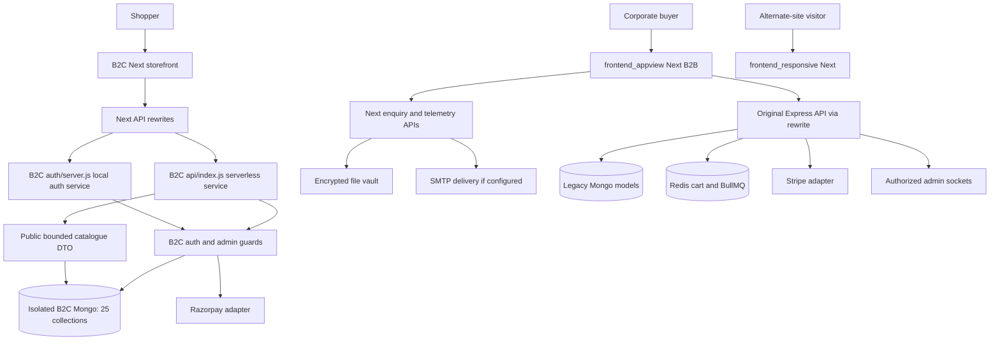
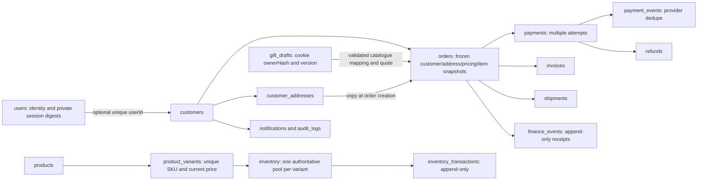
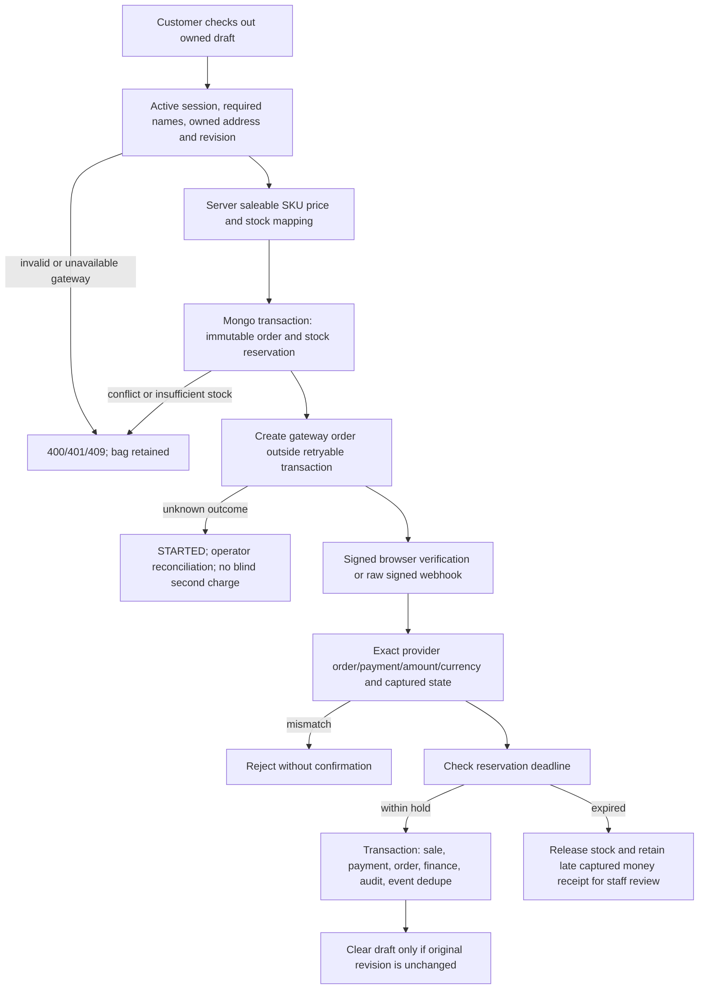
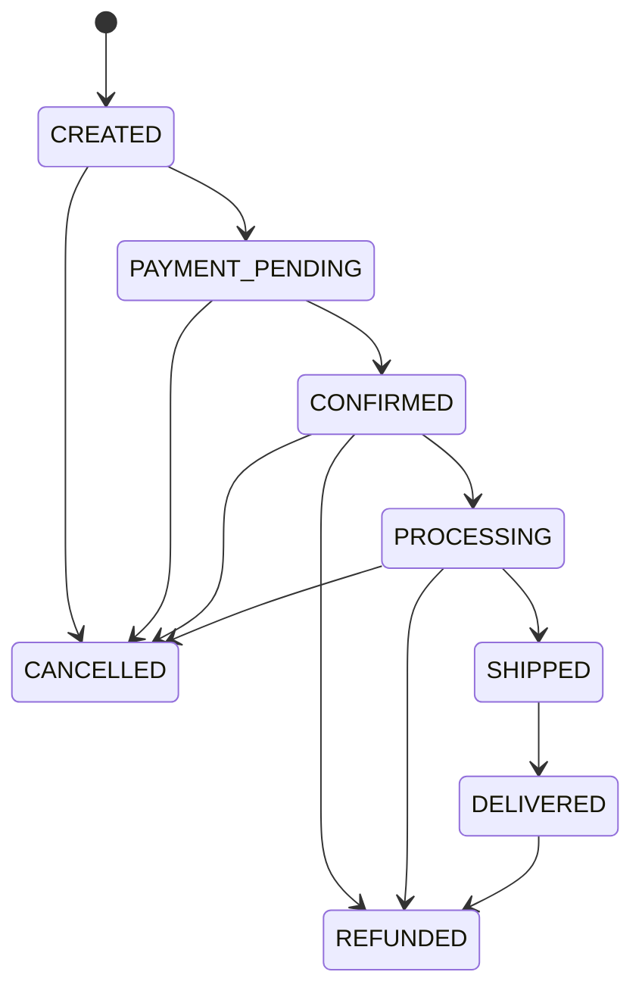
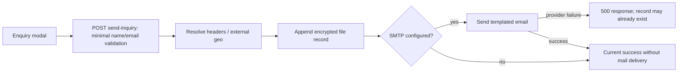
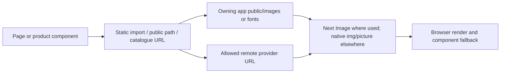
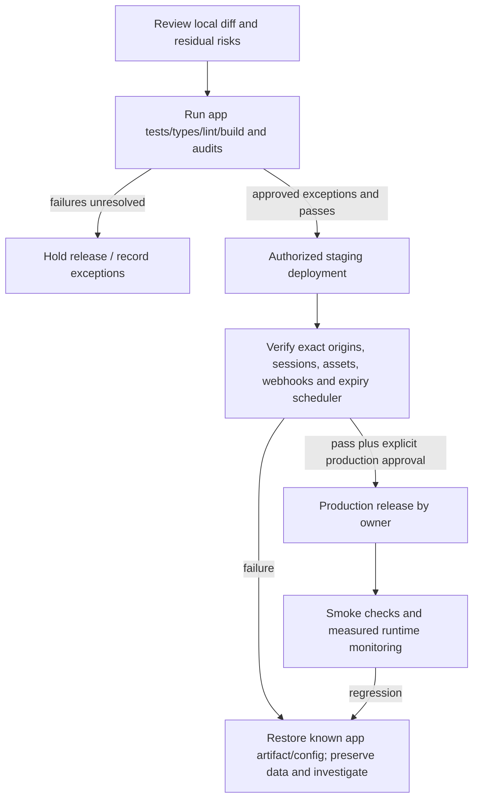

# FLOW.md

## 1. Project Purpose and Scope

Audit date: **2026-10-18**. The Gourmet Gifts contains three independent Next applications and two legacy Express source trees, plus a separate B2C database-backed auth/commerce service. This describes source and isolated local verification; **hosted deployment, live provider flows and recoverable backups are UNKNOWN**.

The current explicit user request adds root audit references. Canonical domain memory remains in [docs/](docs/PROJECT_CONTEXT.md), with historical decisions preserved in [DECISIONS](docs/DECISIONS.md). [DECISION.md](DECISION.md) records this audit's intent, operations and evidence.

| Capability | Classification | Evidence / limit |
| --- | --- | --- |
| Three frontend applications | EXISTS — VERIFIED | Manifests, all three local production builds and TypeScript checks |
| Legacy Express REST APIs | EXISTS — VERIFIED | Both source trees; original full40-test suite; B2C full177-test suite |
| B2C account, admin, draft and checkout APIs | EXISTS — VERIFIED | Disposable Mongo integration suites; provider calls mocked |
| MongoDB / Mongoose + Redis/BullMQ | EXISTS — VERIFIED | Source, disconnected25-collection metadata, isolated replica-set tests, mocked Redis |
| B2B enquiry email and encrypted file vault | PARTIALLY IMPLEMENTED | Source exists; actual mail delivery/durability not verified |
| Signed Cloudinary upload capability | PARTIALLY IMPLEMENTED | Admin signature route exists; file magic/size/storage policy not established |
| Razorpay / Stripe payments | PARTIALLY IMPLEMENTED | B2C signed/owned flows tested with fake gateway; legacy integrity defects remain; no real payment |
| B2C operational invoices/refunds/finance | PARTIALLY IMPLEMENTED | Internal models/guards/tests; provider refunds, legal invoice policy/delivery and accounting recognition are separate |
| Original B2B studio admin | PARTIALLY IMPLEMENTED | Page disabled; API auth tested separately, data/export runtime unverified |
| Password reset / MFA | NOT FOUND | No implemented recovery/MFA route in inspected auth systems |
| Live scheduler, monitoring and restore | UNKNOWN — INSUFFICIENT EVIDENCE | Expiry route/worker source exists; no operational deployment evidence |
| Repository CI workflow | NOT FOUND | No .github workflow or root orchestrating package found |

## 2. Verified Technology Stack

| Application | Local implementation after audit | Checks |
| --- | --- | --- |
| B2C | Next16.4.0, React19, TypeScript, Tailwind4, Framer Motion | Build/types/lint;88 client tests |
| frontend_appview | Next16.4.2 (DEC-003), React19, TypeScript, Tailwind4; Zustand/Query/GSAP | Build/types; scoped changed-file lint; whole-app lint still fails |
| frontend_responsive | Next16.4.2 (DEC-003), React19, TypeScript, Tailwind4 | Build/types; lint has two warnings |
| backend and B2C/backend/src | Express4, Mongoose8, bcryptjs, JWT, ioredis, BullMQ, Stripe, Socket.IO | Legacy integration tests with disposable Mongo and mocked services |
| B2C/backend/{auth,database,admin,gifting,payments,catalogue,api} | Separate opaque-session/role model, Mongo transactions, Google OAuth, Razorpay adapter | Isolated database/API suites; no real gateway exchange |

Node22.12.0/npm10.9.0 used. Installs warned that a transitive ESLint dependency requires a newer supported Node patch (22.13+ on Node22); actual lint commands executed. Do not interpret that warning as supported-toolchain certification. [Canonical stack](docs/TECH_STACK.md).

## 3. Current System Architecture

**Application and persistence boundaries — CURRENT — VERIFIED (source/local tests).** Scope: separate applications and stores; external runtime remains unverified.



B2C/backend/src is a second legacy Express tree initialized by its own src/server.js; it is **not** the serverless B2C api/index.js implementation. Connections in this diagram describe code paths, not deployed routing evidence. Canonical detail: [ARCHITECTURE](docs/ARCHITECTURE.md).

## 4. Repository and Module Flow

| Root | Entry points | Ownership |
| --- | --- | --- |
| B2C | src/app/layout.tsx, page.tsx → /b2c, next.config.ts | Consumer design, StorefrontChrome/Header/CartTray, public assets |
| B2C/backend | api/index.js or auth/server.js; separate src/server.js | api/index mounts auth then catalogue; auth mounts gifting/payments/admin/maintenance; database holds guards/repositories/transactions |
| frontend_appview | src/app/layout.tsx, src/proxy.ts | Main B2B ResponsiveShell, route whitelist, enquiry/telemetry/private export |
| frontend_responsive | src/app/layout.tsx and page.tsx | Independent pastel design and public assets |
| backend | src/server.js → src/app.js | Legacy feature routers, worker, Mongo/Redis/Stripe/socket integrations |
| docs | Canonical domain files | Current rules and preserved historical evidence |
| scripts/audit-repository.cjs | Read source/disconnected metadata; optional --write | Reproducible asset/route/schema documentation only |

No root package/workspace orchestration. Each app owns its npm lockfile. No source branch, commit, push or deployment was made.

## 5. Routes and Page Inventory

All **42 page entry points**, six Next API handler files and116 backend method/path declarations are listed in [ROUTE_INVENTORY](docs/audit/ROUTE_INVENTORY.md) and [machine-readable declarations](docs/audit/route-inventory.json). The JSON includes imports, direct API strings, dynamic parameters, local boundaries and backend method/path declarations. Imports can own transitive data fetching; a declaration is not deployed reachability.

| B2C routes | Entry / shared UI | Access, data, loading/failure and tests |
| --- | --- | --- |
| / → /b2c | app/page.tsx redirect; b2c/page.tsx; Home components | Public catalogue + local photography; preview on unavailable API, no invented saleability. Root error boundary. catalogue/storefront-performance tests |
| /shop, /shop/candles, /shop/envelopes, /shop/hampers, /shop/stationery | Shop/ShopCollectionPage/ProductCard | Public catalogue + curated data; parent shop/loading.tsx; truthful empty/preview/error states; catalogue and gift pricing tests |
| /products/[slug] | products/[slug]/page.tsx; ProductGallery/BuyPanel | Untrusted slug string; public catalogue/static mapping, missing product404; products/loading.tsx and root error. Add remains server draft operation; catalogue/gift-cart tests |
| /boxes → /build; /build | Redirect and GiftBuilder | Guest browser-owned draft API; selected box query is input, not saleable authority; loading boundaries; gifting and client cart tests |
| /cart | GiftCart + CartTray/shared photos/quantity controls | Guest draft cookie; versioned saves, stale409 and ambiguous-write errors; loading boundary; gift-cart/tray/pricing tests |
| /cart/store | LegacyCart | Separate legacy Redis cart API/X-Session-Id; no implicit identity/cart merge; root error boundary; legacy cart tests |
| /account | Account UI | Public sign-in page; me/orders require session and customer ownership; account/loading.tsx; auth/admin-auth client tests |
| /checkout | Checkout component | Server session + draft/order ownership, address validation and authoritative quote/reservation; checkout/loading.tsx; gift-checkout/razorpay tests |
| /admin/[[...segments]] | admin/layout.tsx, AdminPage | Optional string segments; section/24hex-ID allowlist, invalid404; server route serializes no private data. API session/current role/permission gates all resources; admin/loading.tsx; admin-security/reads/mutations/commands tests |

All B2C pages inherit its root layout and public/ assets; admin has separate chrome. Original pages inherit ResponsiveShell; alternate owns its root layout. See JSON for every original page's imports and colocated boundaries.

**Original B2B reachability:** isPageRouteActive hardcodes Home, hampers, collections/11 category paths, contact, offline, employee/milestone/dealer aliases and nine occasion slugs. Dealer alias rewrites to its occasion. Other original pages (including account/cart/checkout/studio-admin) stay disabled. PAGE_ROUTES_CONFIG flags do not alone change the whitelist. Unmatched API config defaults allowed, so internal APIs need their own protection.

## 6. User Role and Permission Flows

| System | Identity | Server authorization |
| --- | --- | --- |
| Legacy Express | access JWT in Bearer header or accessToken cookie; current Mongo User | auth() for ownership flows; auth('admin') for catalogue mutation, upload signature and admin APIs. Public register forces customer |
| Legacy sockets (DEC-002) | Same access JWT; handshake auth.token, Bearer or parsed cookie | Current User admin role at join and **again before each notification**. Invalid/expired/deleted/demoted/storage-failed recipients receive no event and leave room |
| B2C customer | Opaque b2c_session token, digest/expiry in active User | ACTIVE Customer linked by userId; customerId-scoped orders/addresses/payments |
| B2C staff | Same session; OWNER/ADMIN roles | Explicit permissions; ADMIN deny-by-default; owner-only permissions undelegatable. Staff/session changes revoke access; command transactions recheck authorization |
| B2B Next admin (DEC-004) | Explicit configured PIN + signed gourmet_admin_session cookie | Missing config denies token validation and login503. Auth data/export consumers share verification. Shared PIN does not provide individual staff accountability |
| Gift draft | Independent b2c_gift cookie hashed as ownerHash | Browser-owned revisioned draft; same-browser login retains it. No account ownership merge or cross-device recovery implied |

Socket browser origins use exact shared legacy allowlist for CORS and handshake allowRequest; nonbrowser no-Origin access still needs credentials/role. REST CORS omits credentialed response headers for unlisted origins; it is not a complete CSRF control. New B2C mutation Origin policy stays independent/exact. [AUTH_SYSTEM](docs/AUTH_SYSTEM.md), [SECURITY](docs/SECURITY.md).

## 7. Authentication and Session Flow

**B2C account lifecycle — CURRENT — VERIFIED (isolated tests).** Scope: registration/password/Google/session/logout; real Google consent not repeated.

```mermaid
sequenceDiagram
  actor User
  participant UI as B2C Account
  participant API as B2C Auth API
  participant DB as Isolated Mongo
  participant Google as Google adapter
  User->>UI: Register, sign in or select Google
  UI->>API: Credentialed same-origin request
  API->>API: Exact Origin on mutations, bounded JSON and rate checks
  alt Password / registration
    API->>DB: Validate identity and bcrypt hash / create CUSTOMER
  else Google
    API->>DB: Persist hashed state/binding, private nonce/verifier, expiry
    API-->>User: Redirect to Google with PKCE
    User->>API: Return code/state + browser flow cookie
    API->>DB: Atomically consume unexpired matching flow
    API->>Google: Exchange code and verify signature/audience/issuer/nonce
    Google-->>API: Verified claims or error
    API->>DB: Find subject or create new CUSTOMER; same-email collision409
  end
  alt Valid active identity
    API->>DB: Store opaque session digest and expiry
    API-->>UI: HttpOnly session cookie; safe result
    UI->>API: GET me / owned history
    API->>DB: Active session and current customer/role check
    API-->>UI: Projected private, no-store response
  else Invalid / inactive / dependency failure
    API-->>UI: 400/401/409/429 or generic503; no new session
  end
  User->>API: Logout
  API->>DB: Remove session digest
  API-->>UI: Clear cookie
```

B2C cookie path /api/v1/auth, SameSite=Lax, secure for HTTPS; session lifetime seven days. Google state is single-use/ten-minute lookup expiry; TTL is cleanup, not permission. No silent same-email linking. Legacy JWT refresh rotation/reuse detection is separate; logout revokes refresh but existing access JWT lasts to expiry. Password reset/MFA not found. Original B2B admin keeps its configured seven-day HMAC format, canonical timestamp/64hex signature, HttpOnly/SameSite=Strict cookie and existing five-failure/15-minute process-local lock.

## 8. API Request Lifecycle

B2C Next rewrites /api/v1/auth/* to AUTH_BACKEND_URL and other /api/v1/* to BACKEND_URL, with existing production/loopback fallbacks. Serverless api/index.js coalesces warm initialization, checks explicit DB configuration, mounts raw Razorpay webhook before JSON, mounts auth/private routes and public catalogue, returns readiness503 with Retry-After when unavailable. It does not install schemas on cold start. Local auth/server.js mounts auth domains only; its fallback origin remains3001, so operators must configure the actual3000 origin.

Browser mutation flow: Helmet/cookie parser → private,no-store → separately mounted signed webhook → exact Origin check for unsafe auth methods →8KiB JSON (128KiB admin) → process-local general/read limiter → endpoint identity/ownership/schema guards → Mongo or provider adapter → safe DTO. Admin adds persisted IP/actor buckets and explicit permissions. Errors map expected400/401/403/404/409/422/429 and generic503; malformed/oversized JSON400/413.

| API group | Source / dependencies | Boundary |
| --- | --- | --- |
| B2C /auth/{config,google,google/callback,register,login,logout,me,orders} | auth/app.js/service.js/google.js | Public entry + private session-owned reads; provider callback uses consumed state |
| B2C /auth/gift/{catalogue,count,draft,checkout-check,checkout,address,order} | gifting/routes.js, checkout.js | Cookie-owned draft; customer session/address/order ownership for checkout; revision checks |
| B2C /auth/payments/{config,orders/:id,razorpay/order,razorpay/verify,razorpay/webhook} | payments/routes.js/service.js | Session+order ownership on browser payment; raw-body signature on webhook |
| B2C /auth/gift/maintenance/expire | gifting/maintenance.js | Exact constant-time Bearer secret, minimum32 characters, bounded100 expiry batch; fails closed if absent |
| B2C /auth/admin/* | admin/routes.js/security.js/commands.js | Role+permissions+owned current session; bounded resource/ID/query/body; transactional command receipts/audit |
| B2C /products and /products/:slug | catalogue/routes.js | Public safe DTO, literal escaped search, bounded pagination, three-second query limits |
| Legacy /api/v1/auth,users,products,categories,gift-boxing,cart,orders,reviews,coupons,upload,admin | Each src/features/*/*.routes.js and app.js | JWT/current role and controller ownership; public catalogue/search/coupon/review reads; guest Redis cart |
| Legacy /healthz and /api/v1/healthz | health.routes.js | Public dependency health; not proof paid checkout works |
| Original Next /api/send-inquiry,/api/telemetry/collect,/api/geo/detect | src/app/api | Public ingress; validation/PII/HTML-escaping issues remain |
| Original Next /api/admin/{auth,data,export} | Next handlers + adminAuth.ts | Configured shared-PIN session required for data/export; page gating is separate |

[Full declaration inventory](docs/audit/route-inventory.json) preserves method, pattern, source line and relative mount scope; loop-generated admin commands/resources also require admin/routes.js review. [API_CONTRACTS](docs/API_CONTRACTS.md).

## 9. Database Entity and Data Flow

**Mongo ownership and immutable-history boundaries — CURRENT — VERIFIED (source/disposable DB tests).** Scope: B2C document references/embedding; arrows are application references, **not foreign-key constraints**.



25 collections,103 explicit indexes,33 explicit unique constraints (128/58 including _id), verified by disconnected metadata and existing index integration tests. Application guards validate references/state transitions/frozen snapshots; Mongo validators constrain document shapes. Native-driver access can bypass application-only guards. No schema migration/index creation/data transformation was run against a configured database in this audit.

Legacy models are User/Product/Category/Order/Coupon/Review; variants/addresses are embedded and carts in Redis. The encrypted file vault is independent. No cross-domain automatic customer merge. [Current schema](docs/database/CURRENT_SCHEMA.md), [relationship map](docs/database/RELATIONSHIP_MAP.md), [canonical database](docs/DATABASE.md), [models](docs/DATA_MODELS.md).

## 10. Important Business Workflows

**Draft selection and concurrency — CURRENT — VERIFIED (local tests).** Scope: browser draft preservation; it never reserves stock by itself.

```mermaid
sequenceDiagram
  actor Shopper
  participant UI as Card / Cart / Builder
  participant API as Gift API
  participant DB as GiftDraft Mongo
  Shopper->>UI: Add or change quantity / required print names
  UI->>API: Read missing confirmed draft, then PUT revision + selections
  API->>API: Cookie owner hash, valid known IDs/quantities/personalisation
  API->>DB: Compare current version and save with optimistic concurrency
  alt Confirmed write
    DB-->>API: New revision
    API-->>UI: Full safe draft
    UI->>UI: Update count/tray using confirmed event
  else Stale revision
    API-->>UI: 409
    UI->>API: Reload current draft; one conflict-aware retry
  else Ambiguous failure
    API-->>UI: Explicit error
    UI->>UI: Preserve state; no automatic mutation replay/success
  end
```

**Checkout and capture — CURRENT — VERIFIED (local fake-provider tests).** Scope: B2C gifting commerce; no real provider transaction or rollout performed.



Current B2C quote policy is existing source/history: INR integer minor units, approved GST/delivery-inclusive mapped amounts and five-minute holds. The audit introduces **no new prices, tax, shipping, refund or retention policy**. Legacy Stripe checkout remains a separate defect-prone path: client shipping input, tax fallback, provider calls within retried transaction and stock/idempotency races remain unresolved.

**Persisted order transitions — CURRENT — VERIFIED (schema/local tests).** Scope: allowed persistence graph, not proof every transition has an implemented provider/UI workflow.



**B2B enquiry — CURRENT — PARTIALLY VERIFIED (source only).** Scope: public enquiry; SMTP delivery and vault restoration unverified.



Public enquiry HTML interpolation/PII logging and retry/duplicate acknowledgement semantics remain findings; no synthetic enquiry was sent or stored. [USER_FLOWS](docs/USER_FLOWS.md), [orders](docs/ORDER_SYSTEM.md), [payments](docs/PAYMENT_SYSTEM.md).

## 11. File Upload and Image Delivery

**Public asset delivery — CURRENT — VERIFIED (source inventory/build, not every browser decode).** Scope: separate public roots; DEC-001, no asset migration.



Inventory:870 files /439,924,613 bytes across four scopes; dimensions read using installed Sharp metadata where applicable,202 exact duplicate groups,549 files without static matches (not proven unused). One missing literal is in the **unimported** original OtherProductsSection: Classics/thumb.jpeg; an existing thumb.png is referenced elsewhere. No active-page failure established, so do not invent product-photo equivalence or activate that component. Dynamic/remote/CMS/ignored-upload ownership remains outside static proof.

B2C ProductPhoto/gallery implement bounded load recovery; public local asset paths preserved. Root original Next config restricts remote image hosts; all apps mix native and optimized images. Legacy upload/sign requires persisted admin role and generates a Cloudinary signature under a prefixed folder, but server-side byte/magic/dimension validation and effective provider upload limits are UNKNOWN because this API does not receive bytes.

[Asset inventory](docs/assets/ASSET_INVENTORY.md), [folders](docs/assets/ASSET_FOLDER_MAP.md), [migration log](docs/assets/ASSET_MIGRATION_LOG.md), [image report](docs/assets/IMAGE_OPTIMIZATION_REPORT.md).

## 12. External Integrations and Webhooks

| Integration | Implemented path / boundary | Verification limit |
| --- | --- | --- |
| Google | auth/google.js; fixed HTTPS hosts, RS256 keys, issuer/audience/nonce, PKCE | Mocked exchange + isolated identity tests; no real consent |
| Razorpay | payments/razorpay.js, service.js, routes.js | Raw HMAC webhook and browser signature; exact captured money/identity checks tested with fixtures |
| Stripe | Legacy shared/utils/stripe.js and order controller | Raw signature boundary exists; known legacy money/replay/race findings remain |
| Cloudinary | Legacy admin upload-sign helper and remote images | No upload performed; provider security policies UNKNOWN |
| SMTP | Original Next send-inquiry | No message sent; config/delivery UNKNOWN |
| Redis / BullMQ | Legacy carts/limiter/jobs/socket adapter | Mocked in tests; no real Redis failover/load verification |
| Clarity / WhatsApp / geo providers | Original B2B telemetry/contact/geo paths | Source only; privacy/retention and trusted header topology UNKNOWN |

[INTEGRATIONS](docs/INTEGRATIONS.md). No external account message, payment or infrastructure mutation performed.

## 13. Error Handling and Recovery

B2C UI retries only allowlisted GET503 responses once with a finite cooldown up to one second; it does not auto-replay auth/cart/payment mutations or429. Draft409 performs one reload/rebase retry; uncertain writes remain explicit. Public server catalogue uses2.5s shared request budget, bounded fanout and a15s process cooldown. Individual backend catalogue queries use3s maxTimeMS. Gateway I/O has10s timeout.

Mongo session.withTransaction provides driver retry behavior; external payment I/O stays outside B2C retryable transactions. Provider initialization STARTED remains uncertain until reconciled. Unknown captured webhook payment returns retryable503; a durable general failed-event inbox/reconciler is still missing. Known late capture stores money receipt and a review flag, with no false fulfilment or invented automatic refund. Legacy provider/worker/Redis failure compensation remains open.

Vault decryption failure currently falls back to an empty structure; whole-file concurrent replacement and ephemeral serverless paths remain risks. **Do not rotate its key or overwrite records to repair this without backup/restore evidence.** [EDGE_CASES](docs/EDGE_CASES.md), [rollback](docs/database/ROLLBACK_PLAN.md).

## 14. Caching and Performance Flow

Public catalogue fetch revalidates60s; auth/draft/customer data uses private/no-store and in-flight coalescing, without a settled shared private cache. Checkout rereads authoritative prices/stock. B2C selected public wallpaper/logo paths receive one-day caching, hashed hero files one-year immutable caching. The legacy Redis cart and Query/IndexedDB browser caches are distinct from B2C gift state.

This audit measured source payloads and build/test execution only; it did not measure LCP/INP/CLS, field traffic, query explain plans or throughput. No runtime speedup/capacity claim is made. Existing historical lab numbers remain dated in [PERFORMANCE](docs/PERFORMANCE.md). No indexes, image formats, caches or asset URLs were changed as speculative optimizations.

## 15. Background Jobs and Scheduled Tasks

Legacy src/server.js starts BullMQ stock-release worker outside test; original pending orders enqueue a15-minute release. Cross-store exactly-once cancellation/stock behavior remains an existing risk. B2C five-minute gift reservations expire on demand and through the authenticated bounded maintenance route/CLI. Vercel files contain no cron schedule; whether a trusted external scheduler is configured is UNKNOWN. Notification/refund/shipment models do not establish working delivery workers.

## 16. Testing and CI/CD Flow

Each app has independent npm scripts/lock. No repository CI found. Existing backend tests use disposable MongoMemoryReplSet, mocked Redis and fake gateway operations; schema install in those tests touches disposable databases only. Baseline sandbox listener/DNS failures were recorded, then retried with permitted local listeners/registry access. Original/alternate Turbopack builds needed the same listener permission; one concurrent alternate build was rejected by its build lock, then passed after the earlier process exited.

[TESTING](docs/TESTING.md) and [audit report](docs/audit/REPOSITORY_AUDIT.md) record exact command/result/scope, failed pre-fix regressions, final audits and remaining whole-app lint failures. Production-only zero advisories is **not** zero development advisories. DEC-003 dependency changes ran --ignore-scripts and no --force.

## 17. Deployment and Rollback Flow

B2C frontend and backend Vercel configs specify bom1; backend rewrites requests to api/index.js. The frontend build command is npm run build. Original backend also has a Vercel rewrite config, while its traditional server assumes Redis/workers/sockets; hosted topology/runtime compatibility is not established here. Original main Next rewrites point to loopback legacy services and an old3001 B2C port; preserve these until deployment ownership/intent is established.

**Review-to-release process — PROPOSED — NOT IMPLEMENTED automation.** Scope: safe release/recovery, DEC-001/003; no deployment performed.



This is a proposed release procedure, not an existing CI pipeline. No production schema/backups/indexes were inspected or installed. Root audit patches are reversible from the review diff; never Git-reset user work. Future financial/schema/key changes need their own data-aware recovery evidence and approval. [DEPLOYMENT](docs/DEPLOYMENT.md).

## 18. Proposed Architecture Changes

DEC-002 exact CORS/socket authorization and DEC-004 configured admin boundaries are now current local-tested behavior in sections6–8. DEC-003 dependency remediation is current in section2; residual advisories remain. No database restructure, asset migration, provider replacement or new state-management architecture was applied.

**PROPOSED — NOT IMPLEMENTED:** legacy user/payload-bound atomic idempotency and stock/payment compensation; durable failed-event reconciliation; safe vault storage/key recovery; source-appropriate XLSX replacement/update; distributed general auth limits/trusted proxy deployment; approved backup restore/CI/scheduler operations. DEC-003 also completed the local Nodemailer10.1.2 migration and unused original-backend UUID removal, with no-network MIME/handler and backend regressions. Domain priorities and unresolved policy in [TODO](docs/TODO.md)/[MEMORY_GAP_AUDIT](docs/MEMORY_GAP_AUDIT.md) stay in force. These proposals do not authorize production or destructive changes.

## 19. Diagram Index and Verification Status

| Section | Diagram | Verification |
| --- | --- | --- |
| 3 | Application/store boundaries | CURRENT — VERIFIED locally; hosting UNKNOWN |
| 7 | Auth/session sequence | CURRENT — VERIFIED isolated DB/provider fixtures |
| 9 | Mongo reference/snapshot flow | CURRENT — VERIFIED source and temporary DB; no relational FK claim |
| 10 | Draft concurrency | CURRENT — VERIFIED local client/API tests |
| 10 | Checkout/capture/recovery | CURRENT — VERIFIED fake-provider tests; live provider UNKNOWN |
| 10 | Order persistence states | CURRENT — VERIFIED model constraints; not every workflow active |
| 10 | B2B enquiry | CURRENT — PARTIALLY VERIFIED source only |
| 11 | Asset delivery | CURRENT — VERIFIED source inventory/build; all browser loading UNKNOWN |
| 17 | Release/rollback | PROPOSED — NOT IMPLEMENTED automation |

## 20. Maintenance and Update Rules

Record intent/risk/approval/tests/recovery in DECISION.md **before** consequential operations. Record actual results afterward. Update affected canonical domain docs, CURRENT_STATUS/CHANGELOG/TODO and these flows together. Preserve dated history and stable decision IDs; mark superseded statements rather than silently replacing historical evidence. Inventory scripts write documentation only; generated references do not authorize migrations/deletion. No credentials, private URLs, environment values or real customer records belong in documentation.
